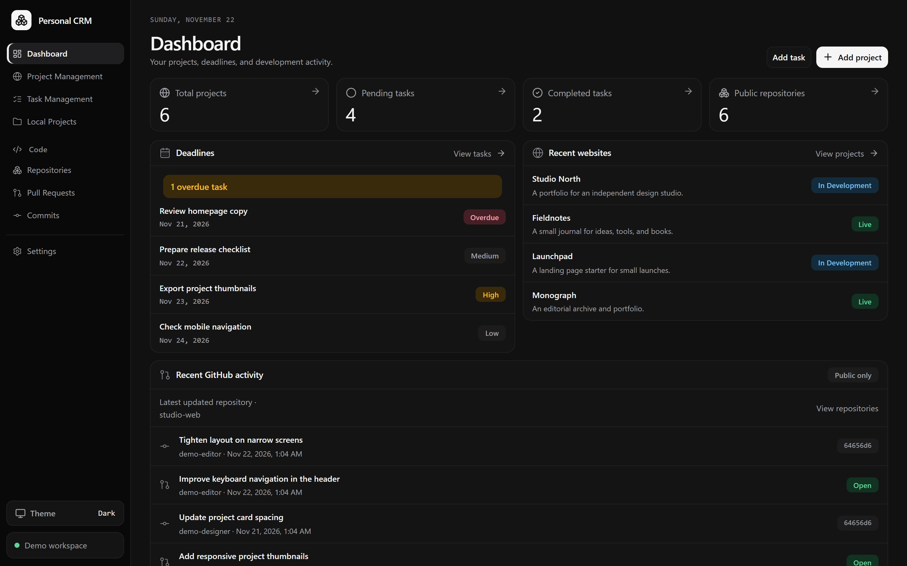

  

<h1 align="center">cmndrCRM Showcase</h1>

A walkthrough of my personal workspace for website projects, tasks, local folders, and public GitHub activity.

<a href="https://cmndrpaul-crm-showcase.vercel.app/">Visit the live showcase</a>

## What you can explore

- **Dashboard** brings upcoming deadlines, recent websites, and public GitHub activity into one view.
- **Projects** groups website work by status with thumbnails and links.
- **Tasks** shows priorities and subtasks in list and Kanban views.
- **Local Projects** stores Windows folder paths and provides copyable PowerShell and CMD commands.
- **Repositories** shows public repository cards with commit activity charts and open pull request counts.
- **Pull Requests** shows public pull requests by repository and status.
- **Commits** shows recent commit messages, authors, and hashes.

The showcase uses sample data. Switch the page theme to see the CRM in the opposite theme.

When replacing walkthrough screenshots, publish them in a new versioned directory and update its path in `index.html`, `showcase.js`, this README, and the cache rule in `vercel.json`. Browsers may keep earlier URLs for a year.

## Built with

The showcase uses HTML, CSS, and JavaScript. The CRM uses React, TypeScript, Vite, Tailwind CSS, and Supabase.

The live CRM is owner-only.
