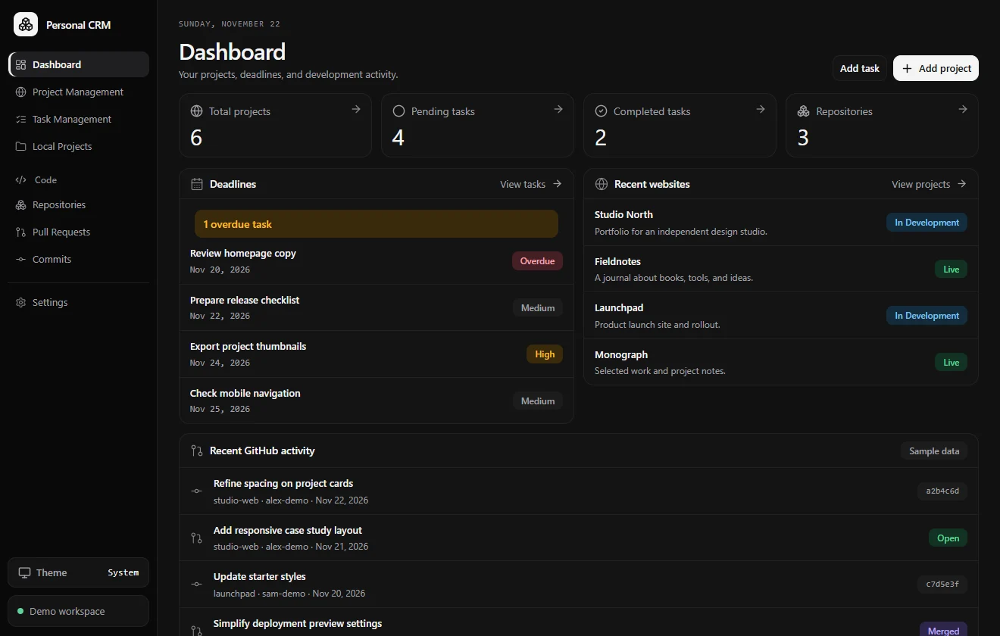

  

<h1 align="center">cmndrCRM Showcase</h1>

A walkthrough of my personal workspace for website projects, tasks, local folders, and public GitHub activity.

## What you can explore

- **Dashboard** brings upcoming deadlines, recent websites, and public GitHub activity into one view.
- **Projects** groups website work by status with thumbnails and links.
- **Tasks** shows priorities and subtasks in list and Kanban views.
- **Local Projects** stores Windows folder paths and provides copyable PowerShell and CMD commands.
- **GitHub** shows public repositories, pull requests, and commits.

The showcase uses sample data. Switch the page theme to see the CRM in the opposite theme, or enlarge any laptop preview for a closer look.

## Built with

The showcase uses HTML, CSS, and JavaScript. The CRM uses React, TypeScript, Vite, Tailwind CSS, and Supabase.

The live CRM is owner-only.
